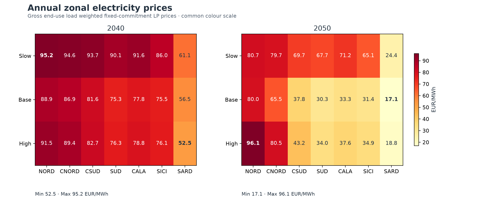

# PyPSA-IT

**PyPSA-based research model of Italy's electricity system and wholesale market, with published 2040 and 2050 zonal scenarios.**

The completed **Zonal** model represents Italy's seven electricity bidding zones with fixed generation and storage capacities, 8,760 hourly snapshots based on a 2019 weather chronology, thermal unit commitment, hydro and pumped storage, batteries, flexible power-to-X demand and cross-border/interzonal exchanges. Physical dispatch comes from a unit-commitment MILP; electricity prices come from a subsequent fixed-commitment LP.

| Model | Status | What it represents |
|---|---|---|
| [Zonal](Zonal/README.md) | **Completed:** six verified 2040/2050 cases | Seven aggregated Italian bidding zones and directional exchange interfaces |
| [Nodal](Nodal/README.md) | **Planned:** no executable model yet | Future, finer-resolution physical transmission-network analysis |

## Published zonal results

Each horizon has **Slow, Base and High** scenarios. The accepted model variants are **2040 `final_v3`** and **2050 `final_v6`**, with full-year reporting and saved numerical QA for all six cases.

**Modeled national electricity-purchasing price (EUR/MWh)**

| Horizon | Slow | Base | High |
|---|---:|---:|---:|
| 2040 | 92.64 | 83.90 | 85.69 |
| 2050 | 74.09 | 58.41 | 69.32 |

These values weight modeled hourly zonal prices by **rigid electricity demand plus P2X withdrawal and represented duration**. They are simulated scenario outcomes, not observed GME prices or probabilistic forecasts. See [results and definitions](Zonal/docs/RESULTS.md) for full precision and the distinct national hourly price-index definition.

*Published zonal-price comparison. [View the full figure set, underlying tables and provenance.](Zonal/docs/FIGURES.md)*

## Download and reproduce

| Resource | What it provides |
|---|---|
| [Source release — `zonal-model-v1.0.0`](https://github.com/postnormaltimes/PyPSA-IT/releases/tag/zonal-model-v1.0.0) | Versioned execution/reporting source, Python 3.11 lock, documentation and selected figures |
| [Numerical results — `zonal-final-results-v1`](https://github.com/postnormaltimes/PyPSA-IT/releases/tag/zonal-final-results-v1) | Hourly zonal prices, modeled national price indices, physical UC generation/dispatch and supplementary CSV/Parquet data for all six cases |
| [Prepared inputs — `zonal-production-data-v3`](https://github.com/postnormaltimes/PyPSA-IT/releases/tag/zonal-production-data-v3) | Verified unsolved networks and supporting inputs for independent scenario execution |
| [Reproducibility guide](Zonal/docs/REPRODUCIBILITY_GUIDE.md) | Three routes: **(A)** inspect results without solver software, **(B)** regenerate figures without optimization, **(C)** independently run one case with the pinned environment and a valid Gurobi licence |

Explore the [model methodology](Zonal/docs/METHODOLOGY.md), [scenario/version evolution](Zonal/docs/FINAL_VERSION_EVOLUTION.md), [source provenance](Zonal/docs/DATA_PROVENANCE.md), [limitations](Zonal/docs/LIMITATIONS.md) and [changelog](Zonal/CHANGELOG.md). Historical releases remain available; their original documents are not the current execution instructions.

## Scope and reuse

The Zonal model is **not** an AC power-flow representation of the Italian grid: within-zone physical transmission constraints are omitted, external markets use modeled boundary conditions, and one weather year is insufficient to establish probabilistic adequacy. Nodal is a planned complementary model family, **not** a completed simulation.

The repository software is [MIT-licensed](LICENSE). Published numerical outputs and figures do not carry a separate blanket data licence here; original source terms and attribution requirements must be assessed independently. See [third-party notices](THIRD_PARTY_NOTICES.md).
